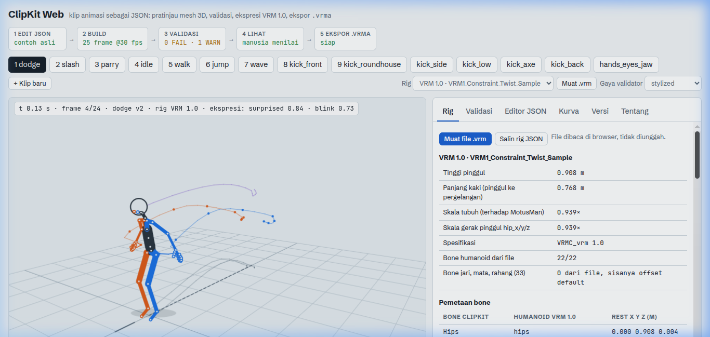
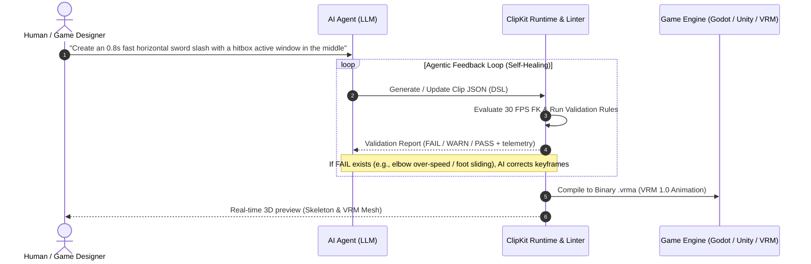

# ClipKit Web

> **AI-First 3D Animation Sandbox, Linter, & Compiler.**  
> A declarative authoring, validation, and ingestion runtime bridging **Large Language Models (LLMs)** with **3D character animation (VRM 1.0 & Godot)**.

[](CHANGELOG.md)
[](tests/)
[](CONTRIBUTING.md)
[](LICENSE)

---



## Table of Contents
- [Vision & Purpose](#vision--purpose)
- [Key Features (v1.6.0)](#key-features-v160)
- [The Agentic Generation Loop](#the-agentic-generation-loop)
- [Documentation Index](#documentation-index)
- [Quick Start](#quick-start)
- [ClipKit Agent CLI](#clipkit-agent-cli)
- [Programmatic Agent API](#programmatic-agent-api)
- [Project Directory Structure](#project-directory-structure)
- [Contributing & License](#contributing--license)

---

## Vision & Purpose

Large Language Models (LLMs) excel at generating structured text and code, but cannot directly output proprietary or opaque binary 3D animation formats (`.fbx`, `.blend`). Binary 3D assets are opaque to tokenization, heavyweight, and lack clear mathematical feedback loops necessary for autonomous self-correction.

**ClipKit Web was built as an execution runtime, linter, and compiler specifically designed for AI agents:**

1. **Token-Friendly Intermediate DSL**: A concise, JSON-based declarative format abstracting complex skeletal transforms into human-readable rotational channels, keyframe arrays, and gameplay windows.
2. **Automated Linter with Structured Feedback**: A rules engine providing exact, actionable errors (`FAIL` and `WARN` with millisecond timestamps and joint names) so an AI can self-heal hallucinations (such as joint hyperextensions, angular snapping, and foot sliding).
3. **Deterministic Forward Kinematics Sandbox**: Evaluates 55-bone skeletal poses (22 body joints, 30 finger bones, 2 eyes, 1 jaw) at 30 FPS in milliseconds without needing GPU rendering, Blender, or external game engine runtimes.
4. **Binary Compiler to `.vrma`**: Compiles verified JSON clips into industry-standard binary glTF (`.vrma` / VRM Animation) containers ready for direct import into Godot, Unity, Blender, or Web avatars.
5. **Inbound Ingestion & Inverse Solver**: Ingests raw `.vrma`, `.glb`, or `.bvh` motion capture, decompiles 3D quaternions back into high-level ClipKit channels, and applies easing-aware curve compression ($> 60\%$ keyframe reduction).

---

## Key Features (v1.6.0)

- **Clean Architecture Core**: Strictly enforced layer separation (Domain, Application, Infrastructure, Presentation, Composition Roots) verified by automated architectural boundary tests.
- **Rule Registry Linter**: Modular rule evaluators for angular speed, anatomical limits, floor penetration, foot sliding, root motion continuity, cyclic loops, and VRM 1.0 humanoid bone constraints.
- **Agent CLI (`clipkit`)**: 12 headless commands for validation, check, schema diagnostics, export, import, layer composition, variant comparison, and deterministic editing.
- **Automated Overlap Engine**: Hierarchical kinetic chain delay propagation (pelvis -> spine -> shoulders -> wrists) and decaying sinusoidal overshoot (`outElastic`).
- **Mocap Ingestion & Inverse Solver**: Parse hierarchical ASCII BVH or binary VRMA/GLB files, filter sensor jitter with zero phase shift, and compress keyframes via easing Ramer-Douglas-Peucker (RDP).
- **Headless Contact Sheet Renderer**: Generate annotated SVG contact sheets with COM balance projection, foot contact indicators, and JSON telemetry sidecars.
- **Modular Layer Composition**: Combine partial animations with `override` and `additive` modes using channel glob patterns and time offsets.
- **Variant Branching**: Track immutable versions with `manifest.json` and compare kinematics across variants.

---

## The Agentic Generation Loop



---

## Documentation Index

Comprehensive documentation guides are organized in the [`docs/`](docs/) directory:

- [CLI Reference Guide](docs/cli.md): Complete command-line manual (`validate`, `check`, `export`, `import`, `compose`, `compare`, `edit`, `poses`).
- [Animation DSL Specification](docs/dsl-specification.md): Schema reference, channels, easing curves, gameplay windows, root motion, and layer composition.
- [Web UI & Walkthrough Guide](docs/web-ui.md): Interactive 3D viewport, real-time validation, editor with procedural overlap controls, and curve visualizer with UI screenshots.
- [Validation Rules & Limits Matrix](docs/validation-rules.md): Detailed 8-rule registry, mathematical thresholds, style limits (`realistic`, `stylized`, `exaggerated`), and structured issue hints.
- [Clean Architecture Guide](docs/architecture.md): Layer dependency rules, Port & Adapter interfaces, forward kinematics and inverse solver pipelines.
- [Channels & Humanoid Rig Reference](docs/channels-and-rig.md): 55-bone humanoid catalog (22 canonical body joints plus fingers, eyes and jaw), aim spherical coordinates, and axial sign conventions.
- [Programmatic Agent API Reference](docs/agent-api.md): Integration guide for `window.clipkit` and headless browser automation frameworks (Playwright, Puppeteer).
- [Changelog](CHANGELOG.md): Complete release history from v1.0.0 to v1.6.0 following Keep a Changelog.
- [Contributing Guidelines](CONTRIBUTING.md): Architectural rules, code organization, and pull request workflows.
- [Agent Skill Guide](skills/clipkit/SKILL.md): Agent prompt guide, workflow principles, and reference sheets.

---

## Quick Start

### Prerequisites
- **Node.js**: Version `>= 18.0.0` (or **Bun** `>= 1.0`).
- **Modern Browser**: Chrome, Edge, Firefox, or Safari with WebGL.

### Installation & Scripts
```bash
# 1. Clone the repository and install dependencies
git clone https://github.com/deftorch/clipkit-web.git
cd clipkit-web
npm install

# 2. Run local development sandbox
npm run dev
# Open http://localhost:5173

# 3. Run automated test suite (30 suites, 183 tests)
npm test

# 4. Check code quality & formatting with Biome
npm run check

# 5. Build standalone single-file distribution and CLI
npm run build
# Produces dist/index.html (zero external dependencies) and bin/clipkit.mjs

# 6. Build agent skill package
npm run build:skill
# Produces skills/clipkit.skill
```

---

## ClipKit Agent CLI

The bundled CLI is located at `bin/clipkit.mjs`:

```bash
# Validate clip against kinematics and anatomical limits
node bin/clipkit.mjs validate src/data/clips/slash.json --json

# Run diagnostics and render annotated SVG contact sheet
node bin/clipkit.mjs check src/data/clips/walk.json --sheet ./out --json

# Export to binary VRM 1.0 Animation (.vrma)
node bin/clipkit.mjs export src/data/clips/dodge.json --out dodge.vrma

# Ingest and decompile external BVH or VRMA mocap
node bin/clipkit.mjs import mocap.bvh --output walk.json --filter-jitter --report

# Flatten multi-layer composition
node bin/clipkit.mjs compose layered_clip.json --output flat_clip.json

# Compare variants side-by-side
node bin/clipkit.mjs compare clipA.json clipB.json --sheet ./diff --json

# Perform deterministic edits (mirror, retime, scale-amplitude, close-loop)
node bin/clipkit.mjs edit mirror attack_r.json --output attack_l.json
```

See [docs/cli.md](docs/cli.md) for complete options and output examples.

---

## Programmatic Agent API

In browser and headless testing environments (Playwright, Puppeteer), ClipKit exposes a unified Agent API at `window.clipkit`:

```javascript
// Example programmatic usage via window.clipkit:
const clip = window.clipkit.curItem().clip;

// 1. Validate clip against limits
const res = window.clipkit.validate(clip, 'stylized');
if (res.failCount === 0) {
  // 2. Export to binary VRMA Blob
  const vrmaBlob = window.clipkit.exportVrma(clip);

  // 3. Render headless contact sheet
  const sheet = window.clipkit.renderContactSheet(clip, { frameCount: 8 });
}

// 4. Ingest external mocap programmatically
const imported = window.clipkit.importBvh(bvhText, { epsilon: 0.8 });
```

---

## Project Directory Structure

```
clipkit-web/
├── bin/
│   └── clipkit.mjs              # Standalone bundled CLI executable
├── docs/                        # Comprehensive documentation
│   ├── cli.md                   # CLI command reference
│   ├── dsl-specification.md     # Animation DSL schema specification
│   ├── web-ui.md                # Interactive UI and feature guide
│   └── images/                  # UI walkthrough screenshots
├── skills/
│   └── clipkit/                 # Autonomous agent skill package & evals
├── src/
│   ├── domain/                  # Pure math, kinematics, solver & validation rules
│   │   ├── animation/           # Easing, inverse-solver, overlap, compose, compare
│   │   ├── math/                # Vec3 & Quat mathematics
│   │   ├── rig/                 # Forward Kinematics pose evaluation
│   │   └── validation/          # Modular rule registry (8 rules)
│   ├── application/             # Application stores, state, and ports
│   ├── infrastructure/          # Adapters (Three.js renderer, VRMA/BVH I/O, storage)
│   ├── presentation/            # 3D viewport, 2D canvas renderers, UI panels
│   └── data/                    # Canonical rigs (MotusMan, VRM) & 14 reference clips
└── tests/                       # 30 automated test suites (183 tests)
```

---

## Contributing & License

- Issues and Pull Requests are welcome. Review [CONTRIBUTING.md](CONTRIBUTING.md) for architectural guidelines and testing requirements.
- Licensed under the [MIT License](LICENSE).
