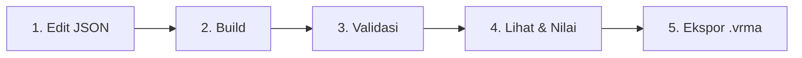

# ClipKit Web

> **Platform authoring, inspeksi kurva, validasi gerak/gameplay, dan ekspor animasi karakter berbasis JSON untuk VRM 1.0 & Godot Engine.**

---

## Daftar Isi
- [Tentang Proyek](#tentang-proyek)
- [Masalah yang Dipecahkan](#masalah-yang-dipecahkan)
- [Fitur Utama](#fitur-utama)
- [Spesifikasi & Format Animasi](#spesifikasi--format-animasi)
- [Kebutuhan Sistem & Prasyarat](#kebutuhan-sistem--prasyarat)
- [Panduan Penggunaan (Quickstart)](#panduan-penggunaan-quickstart)
- [Alur Kerja (Workflow Pipeline)](#alur-kerja-workflow-pipeline)
- [Pintasan Keyboard & Navigasi](#pintasan-keyboard--navigasi)
- [Struktur Direktori](#struktur-direktori)

---

## Tentang Proyek

**ClipKit Web** adalah aplikasi web interaktif yang memungkinkan technical animator, game developer, dan desainer gameplay untuk **menulis, mengukur, memvalidasi, dan menguji klip animasi karakter secara langsung di browser**.

Alih-alih mengandalkan file animasi biner yang berat atau harus membuka software DCC (seperti Blender/Maya) dan game engine penuh (Godot) hanya untuk mengubah timing beberapa frame, ClipKit memperlakukan animasi sebagai **data deklaratif berbasis JSON**.

Animasi dievaluasi menggunakan mesin **Forward Kinematics (FK)** 22 sendi yang deterministik pada 30 FPS, menghasilkan posisi sendi dan lintasan yang identik dengan runtime Godot Engine (selisih posisi < 0.1 mm).

---

## Masalah yang Dipecahkan

1. **Iterasi Cepat Timing Gameplay**: Mengubah durasi *windup*, *hitbox active*, atau *cancel window* pada serangan aksi tanpa proses re-bake / re-export yang lambat.
2. **Validasi Anatomi & Kualitas Gerak Otomatis**: Memastikan animasi tidak mengalami gerakan patah (*angular velocity/acceleration spikes*), melintir di luar batas anatomi alami manusia, atau *foot sliding* saat kaki bertumpu.
3. **Penyelarasan Multi-Karakter (Retargeting VRM 1.0)**: Klip animasi yang sama dapat langsung diterapkan ke berbagai avatar VRM 1.0 dengan proporsi tubuh berbeda, dengan penyesuaian otomatis pada skala langkah dan tinggi pinggul.
4. **Portabilitas Aset**: Animasi dapat langsung diekspor dari browser menjadi file standar industri **`.vrma` (VRM Animation)** yang siap dimasukkan ke game engine atau aplikasi avatar VTuber.

---

## Fitur Utama

### 1. Visualizer 3D & 2D Hybrid
- **Skeletal Stick-Figure**: Boneka rangka garis 22 sendi dengan pewarisan sisi (*Left/Right/Center*), visualisasi kepala berpenanda arah hadap, bayangan lantai dinamis, dan panah orientasi root.
- **Render Mesh 3D VRM 1.0**: Dukungan render model 3D nyata secara langsung melalui WebGL (Three.js + `@pixiv/three-vrm`).
- **Trails & Onion Skinning**: Jejak lintasan sendi ekstremitas (kedua tangan, kedua kaki, kepala) dengan penanda warna jendela aksi, serta pratinjau siluet *onion skin* multi-frame.
- **Kamera Orbit Bebas**: Kontrol rotasi yaw/pitch, zoom pinch/wheel, serta tombol sudut pandang instan (*Depan*, *Samping*, *Atas*, *3/4 Prespektif*).

### 2. Mesin Validasi Otomatis (Validation Engine)
Secara otomatis mengevaluasi puluhan aturan kualitas pada setiap frame (30 FPS):
- **Kecepatan & Percepatan Sudut**: Menilai batas gaya gerak (*stylized* vs *realistic*) untuk mencegah diskontinuitas visual.
- **Lantai & Tumpuan Kaki (Foot Sliding)**: Mengukur ketinggian sendi telapak/jari kaki terhadap lantai dan mendeteksi pergeseran tidak wajar saat bertumpu.
- **Batas Rentang Anatomi**: Memeriksa apakah rotasi leher, tulang belakang, lutut, siku, dan pinggul berada dalam rentang wajar manusia.
- **Kontinuitas Loop**: Memastikan frame awal dan akhir cocok pada klip yang ditandai `loop: true` (seperti *walk* atau *idle*).
- **Kecepatan Root Motion**: Memvalidasi kecepatan translasi tubuh agar tidak terjadi lonjakan jarak instan.

### 3. Jendela Aksi Gameplay (Combat Windows) & Events
- **Timeline Berwarna**: Visualisasi lane untuk jendela aksi `hitbox` (merah), `active` (oranye), `parry` (emas), `cancel` (biru), dan `invulnerable` (hijau).
- **Event Markers**: Penempatan penanda event berwaktu (misalnya pemicu suara SFX, spawn partikel VFX, atau getaran kamera) dengan sinkronisasi playhead.
- **Grafik Kecepatan Terintegrasi**: Kurva kecepatan sudut dan kecepatan translasi root yang dinormalisasi terhadap ambang batas batas peringatan (*warn/fail*).

### 4. Ekosistem VRM 1.0 & Ekspor `.vrma`
- **Muat Model Sendiri**: Seret dan lepas (*drag & drop*) file `.vrm` apa pun ke dalam kanvas.
- **Inspeksi Metadata**: Memeriksa kelengkapan humanoid bones, bone sintetis, jumlah mesh, dan segitiga poligon.
- **Ekspor Instan**: Menghasilkan file binary glTF `.vrma` valid dengan satu klik tombol **Ekspor .vrma**.

### 5. Editor JSON & Diff Riwayat Versi
- **Editor Langsung**: Mengedit JSON klip langsung di browser dengan format rapi otomatis, duplikasi klip, dan validasi sintaks instan.
- **Diff Snapshot**: Membandingkan perubahan pada klip kerja terhadap snapshot versi yang dirilis (menyorot perubahan yang memengaruhi gameplay secara khusus).
- **Inspektur Kurva Interaktif**: Grafik SVG interaktif per channel yang menampilkan batas anatomi rig, nilai default, dan manipulasi playhead.

---

## Spesifikasi & Format Animasi

Sebuah klip ClipKit adalah dokumen JSON mandiri dengan skema terstruktur:

```json
{
  "name": "slash",
  "format_version": 1,
  "version": 1,
  "changelog": [
    { "v": 1, "catatan": "Tebasan horizontal tangan kanan." }
  ],
  "duration": 0.8,
  "loop": false,
  "channels": {
    "lean": [[0, 0], [0.3, 15, "inOutSine"], [0.8, 0, "outQuad"]],
    "armR_elev": [[0, -70], [0.35, 45, "outQuad"], [0.8, -70, "inOutSine"]],
    "armR_azim": [[0, -20], [0.35, 80, "outQuad"], [0.8, -20, "inOutSine"]]
  },
  "windows": {
    "hitbox": [0.3, 0.45],
    "cancel": [0.55, 0.8]
  },
  "events": [
    { "t": 0.3, "type": "sfx", "id": "slash_swing" }
  ],
  "move": [
    { "dir": [0, 0, 1], "distance": 0.8, "t0": 0.1, "t1": 0.4, "ease": "outQuad" }
  ]
}
```

### Parameter Utama:
- `duration`: Durasi klip dalam detik (0 s.d. 30 detik).
- `channels`: Kumpulan keyframe `[waktu_detik, nilai_derajat_atau_meter, tipe_easing]`.
- `windows`: Rentang waktu `[t_mulai, t_selesai]` untuk mekanik gameplay.
- `events`: Titik pemicu event diskret pada waktu tertentu `t`.
- `move`: Segmen perpindahan root motion (arah `[x,y,z]`, jarak tempuh, rentang waktu, kurva translasi).

---

## Kebutuhan Sistem & Prasyarat

### Perangkat Lunak:
- **Node.js**: Versi `18.0.0` atau yang lebih baru (disarankan LTS v20+) **ATAU** runtime **Bun** (v1.0+).
- **Manajer Paket**: `npm`, `pnpm`, `yarn`, atau `bun`.

### Peramban Web (Browser):
- Google Chrome / Chromium v90+
- Mozilla Firefox v90+
- Microsoft Edge v90+
- Apple Safari v15+
- *Kartu grafis / driver yang mendukung WebGL untuk tampilan render mesh 3D.*

---

## Panduan Penggunaan (Quickstart)

### 1. Instalasi Dependensi
Jalankan di terminal proyek:
```bash
npm install
```
*(Atau dengan Bun: `bun install`)*

### 2. Menjalankan Server Pengembangan (Dev Mode)
```bash
npm run dev
```
Buka browser pada alamat yang ditampilkan di terminal (default: `http://localhost:5173`).

### 3. Menjalankan Pengujian Unit (Test Suite)
Untuk memverifikasi keakuratan matematika FK, evaluasi pose, dan kepatuhan VRM 1.0:
```bash
npm test
```

### 4. Membangun Bundel Mandiri (Production Build)
Untuk mendistribusikan aplikasi sebagai satu file HTML mandiri:
```bash
npm run build
```
Hasil build akan tersimpan di `dist/index.html` (berukuran ~900 KB, mencakup seluruh engine Three.js, CSS, shader, parser, dan aset klip bawaan tanpa dependensi server tambahan). File ini dapat dibuka langsung secara offline atau dihosting di static hosting mana pun.

---

## Alur Kerja (Workflow Pipeline)

Aplikasi menyajikan panduan tahapan visual di bagian atas layar:



1. **Edit JSON**: Tulis atau sesuaikan keyframe rotasi channel dan timing jendela aksi.
2. **Build**: Mesin menghitung seluruh pose 30 frame per detik dan kurva kecepatan secara instan.
3. **Validasi**: Periksa laporan otomatis untuk memastikan tidak ada pelanggaran *FAIL* dan perhatikan petunjuk *WARN*.
4. **Lihat & Nilai**: Putar animasi di viewport 3D, putar sudut kamera, dan periksa lintasan tangan/kaki.
5. **Ekspor .vrma**: Simpan file `.vrma` untuk digunakan di Godot, Unity, Blender, atau aplikasi VTuber.

---

## Pintasan Keyboard & Navigasi

| Pintasan | Fungsi |
|---|---|
| <kbd>Spasi</kbd> | Putar / Jeda animasi (*Play/Pause*) |
| <kbd>,</kbd> (Koma) | Mundur 1 frame |
| <kbd>.</kbd> (Titik) | Maju 1 frame |
| <kbd>[</kbd> / <kbd>]</kbd> | Memperlambat / mempercepat kecepatan pemutaran |
| <kbd>1</kbd> s.d. <kbd>9</kbd> | Memilih klip animasi berdasarkan nomor urut tab |
| **Klik Kiri + Geser** | Memutar sudut pandang kamera 3D (*Orbit*) |
| **Scroll Mouse** | Memperbesar / memperkecil tampilan (*Zoom*) |
| **Sentuh 2 Jari** | Cubit untuk zoom (*Pinch Zoom*) pada layar sentuh |
| **Drag & Drop File** | Seret file `.vrm` atau `.glb` langsung ke viewport untuk memuat model baru |

---

## Struktur Direktori

```
clipkit-web/
├── index.html                   # Halaman HTML utama
├── package.json                 # Konfigurasi dependensi proyek
├── vite.config.js               # Konfigurasi Vite & bundling single-file
├── src/
│   ├── main.js                  # Entry point bootstrap aplikasi
│   ├── styles/                  # Styling & tema antarmuka
│   ├── domain/                  # Logika inti (matematika, FK pose, easing, validasi, VRMA)
│   ├── infrastructure/          # Adapter Three.js 3D & GLB/VRM parser
│   ├── application/             # State manajemen (playback, clip, camera, rig, theme)
│   ├── presentation/            # Komponen UI, controller viewport, dan timeline canvas
│   └── data/                    # Definisi rig bawaan dan 14 klip animasi JSON
└── tests/                       # Unit tests (golden pose evaluator & parser VRM)
```
