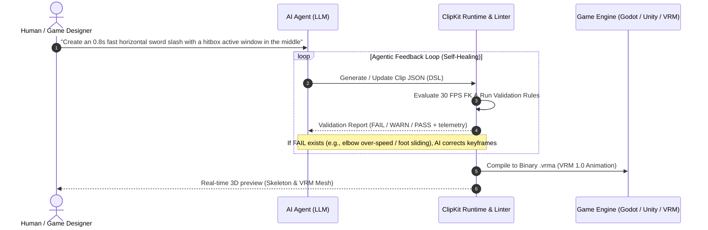

# ClipKit Web

> **AI-First 3D Animation Sandbox, Linter, & Compiler.**  
> A declarative authoring and validation runtime designed to bridge **Large Language Models (LLMs)** with **3D character animation (VRM 1.0 & Godot)**.

---

## Table of Contents
- [Vision & Purpose](#vision--purpose)
- [The Agentic Generation Loop](#the-agentic-generation-loop)
- [Why This Architecture Fits AI](#why-this-architecture-fits-ai)
- [Animation DSL Specification](#animation-dsl-specification)
- [Automated Validation Rules Matrix](#automated-validation-rules-matrix)
- [System Requirements & Usage](#system-requirements--usage)
- [Programmatic & Agent Integration](#programmatic--agent-integration)
- [Project Directory Structure](#project-directory-structure)

---

## Vision & Purpose

Large Language Models (LLMs) excel at generating structured text and code, but **cannot directly output proprietary or binary 3D animation formats** (such as `.fbx`, `.blend`, or binary engine formats). Binary 3D assets are opaque to tokenization, heavyweight, and lack clear mathematical feedback loops necessary for autonomous self-correction.

**ClipKit Web was built as an execution runtime, linter, and compiler specifically designed for AI agents:**

1. **Token-Friendly Intermediate DSL**: A concise, JSON-based declarative format that abstracts complex skeletal transforms into human-readable rotational channels, keyframe arrays, and gameplay windows.
2. **Automated Linter with Structured Feedback**: A rules engine that provides exact, actionable errors (`FAIL` and `WARN` with millisecond timestamps and joint names) so an AI can self-heal hallucinations (such as joint hyperextensions, angular snapping, and foot sliding).
3. **Deterministic Forward Kinematics Sandbox**: Evaluates 22-joint skeletal poses at 30 FPS in milliseconds without needing GPU rendering, Blender, or game engine runtimes.
4. **Binary Compiler to `.vrma`**: Compiles verified JSON clips into industry-standard binary glTF (`.vrma` / VRM Animation) files ready for direct import into Godot, Unity, Blender, or Web avatars.

---

## The Agentic Generation Loop



---

## Why This Architecture Fits AI

### 1. Motion Representations that LLMs Can Reason About
Instead of forcing an AI to calculate thousands of raw transform matrices, ClipKit exposes semantic, high-level channels:
- **Anatomical Rotation Channels**: `lean`, `twist`, `head_pitch`, `armR_elev`, `armR_azim`, `legL_swing`, `kneeL`, etc.
- **Eased Keyframes**: `[time_seconds, value_degrees_or_meters, "inOutSine" | "outQuad" | "linear"]`.
- **Directional Root Motion**: Explicit movement vectors `[x, y, z]`, distances, and translation intervals.
- **Combat Mechanics Windows**: `hitbox`, `cancel`, `parry`, and `inv`.

### 2. Structured Error Messages as Self-Correction Prompts
When an LLM produces unnatural or physically impossible movements, the validator returns precise compiler errors:
```text
[FAIL] angular velocity RightForeArm max 1420.5°/s at t=0.33s exceeds limit 1200.0°/s
[WARN] foot sliding LeftToeBase detected 0.18 m while planted at t=0.40s..0.60s
[FAIL] knee LeftLeg bent backwards (angle -12.4° at t=0.20s), anatomy forbids hyperextension
```
These messages serve as deterministic feedback prompts for the next agent iteration, directing the AI to the exact channel, parameter, and timestamp to fix.

### 3. Direct Compilation to Industry Standards
Once the AI resolves all `FAIL` issues, ClipKit serializes the channel data into a compliant binary glTF container with the `VRMC_vrm_animation` extension. The result is a production-ready game asset, not an abstract mockup.

---

## Animation DSL Specification

The AI produces a JSON object following this schema:

```json
{
  "name": "slash_horizontal",
  "format_version": 1,
  "version": 1,
  "changelog": [
    { "v": 1, "catatan": "Initial fast sword slash draft." }
  ],
  "duration": 0.8,
  "loop": false,
  "channels": {
    "lean": [[0, 0], [0.3, 15, "inOutSine"], [0.8, 0, "outQuad"]],
    "twist": [[0, -20], [0.35, 30, "outQuad"], [0.8, 0, "inOutSine"]],
    "armR_elev": [[0, -70], [0.35, 45, "outQuad"], [0.8, -70, "inOutSine"]],
    "armR_azim": [[0, -20], [0.35, 80, "outQuad"], [0.8, -20, "inOutSine"]]
  },
  "windows": {
    "hitbox": [0.3, 0.45],
    "cancel": [0.55, 0.8]
  },
  "events": [
    { "t": 0.3, "type": "sfx", "id": "slash_heavy" }
  ],
  "claims": {
    "duration": 0.8,
    "tolerance": 0.05
  },
  "validate": {
    "foot_slide": true
  }
}
```

### Parameter Reference
- `duration`: Total duration in seconds (0 to 30s).
- `channels`: Dictionary of named channels mapped to sorted keyframes: `[t, value, easing?]`.
- `windows`: Active time intervals `[start_t, end_t]` for gameplay states.
- `events`: Discrete trigger markers at specific times `t` (e.g. audio triggers, VFX spawns).
- `move`: Directional root motion segments (`dir: [x,y,z]`, `distance`, `t0`, `t1`, `ease`).

---

## Automated Validation Rules Matrix

ClipKit automatically tests AI-generated clips against quality and physics heuristics:

| Category | Metric Tested | FAIL / WARN Condition |
|---|---|---|
| **Angular Velocity** | Inter-frame rotation rate (°/s) | Exceeds stylistic threshold (*stylized* vs *realistic*) |
| **Angular Acceleration** | Rotation acceleration spikes | Indicates unnatural snapping or popping |
| **Floor & Foot Contact** | Planted foot and toe joint heights | Joints penetration into floor or sliding while planted |
| **Anatomical Limits** | Natural human range of motion | Hyperextension of knees/elbows or extreme neck twisting |
| **Loop Continuity** | Start vs end frame pose difference | Cyclic animations (*walk*, *run*, *idle*) not blending seamlessly |
| **Root Motion** | Translational velocity vectors | Discontinuous displacement jumping across frames |
| **Gameplay Windows** | Action interval ordering | Overlapping or out-of-bounds combat windows |
| **VRM 1.0 Compliance** | Standard T-Pose & Humanoid bones | Missing bones, reversed forward vectors, or invalid hierarchy |

---

## System Requirements & Usage

### Prerequisites
- **Node.js**: Version `>= 18` or **Bun** runtime (`>= 1.0`).
- **Modern Browser**: Google Chrome, Edge, Firefox, or Safari (with WebGL support).

### Commands
```bash
# 1. Install dependencies
npm install

# 2. Run local development sandbox
npm run dev
# Open http://localhost:5173

# 3. Run unit tests (for CI/CD or automated AI integration)
npm test

# 4. Build standalone single-file distribution
npm run build
# Produces dist/index.html (runs offline without any external assets)
```

---

## Programmatic & Agent Integration

ClipKit exposes its core engine to the browser global scope (`window.ClipKit` and `window.__clipkit`), enabling headless automated browser agents (such as Playwright, Puppeteer, or IDE subagents) to run validation and export programmatically:

```javascript
// Programmatic validation and export workflow:
import ClipKit from './src/domain/clipkit.js';

const clipJson = { /* ... AI-generated JSON clip ... */ };

// 1. Evaluate & validate clip
const res = ClipKit.validate(rig, ctx, limits, clipJson, 'stylized');

if (res.lines.some(line => line[0] === 'FAIL')) {
  // Feed errors back to AI prompt for self-correction:
  const failures = res.lines.filter(line => line[0] === 'FAIL');
  console.error("AI must correct:", failures);
} else {
  // 2. Once valid, compile directly to binary .vrma
  const vrmaBlob = ClipKit.buildVrmaGlb(rig, ctx, clipJson);
  // Send blob to game engine or save to disk
}
```

---

## Project Directory Structure

```
clipkit-web/
├── index.html                   # Clean HTML entry shell
├── package.json                 # Project dependencies (three, @pixiv/three-vrm, vite, vitest)
├── vite.config.js               # Vite configuration with single-file bundling
├── src/
│   ├── domain/                  # Pure math, animation & validation engine (AI target API)
│   │   ├── math/                # 3D vectors & Quaternions
│   │   ├── animation/           # Easing curves, keyframes, & root motion evaluators
│   │   ├── rig/                 # Rig context & Forward Kinematics pose evaluator
│   │   ├── validation/          # Automated linter & rule evaluation engine
│   │   └── clipkit.js           # Unified facade export
│   ├── infrastructure/          # I/O adapters (Three.js 3D mesh renderer & GLB parser)
│   ├── application/             # Application stores (playback, clip, camera, rig, theme)
│   ├── presentation/            # Canvas viewports, timeline renderer, & UI panel components
│   └── data/                    # Default MotusMan/VRM rigs & 14 reference JSON clips
└── tests/                       # Unit tests (golden pose evaluator & VRM parser)
```
