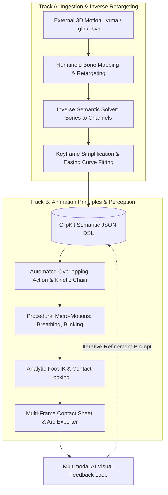

# ClipKit Web — Development Roadmap

## Strategic Objective

The goal of this roadmap is to elevate ClipKit Web from a declarative animation validator into an **autonomous AI animation production platform**. 

Currently, AI generates skeletal animation in a vacuum: it cannot visually inspect its own poses, must manually author every overlapping secondary motion, and lacks the ability to ingest real-world motion capture data. This roadmap establishes two convergent development tracks to solve these limitations:

1. **Track A: Motion Ingestion & Inverse Decomposition (Inbound)**: Ingest dense external 3D animations (`.vrma`, `.glb`, `.bvh`, mocap) and decompile them into clean, editable, semantic JSON DSL clips with sparse keyframes and easing curves.
2. **Track B: Animation Principles & Visual Perception (Outbound)**: Provide the AI with visual inspection tools (contact sheet strips with motion arcs) and automated animation mechanics (kinetic chain overlap, anticipation templates, procedural micro-motion, and foot locking IK).

---

## Architectural Overview

---

## Phased Execution Plan

### Phase 1: Visual Perception & Contact Sheet Exporter
*Objective: Enable multimodal AI to "see" key poses, silhouettes, and motion arcs without human intervention.*

- **1.1 Multi-Frame Strip Renderer**: Implement a headless and client-side renderer that captures key action poses (e.g. 6 to 12 frames) across the animation timeline into a single composite image strip (contact sheet).
- **1.2 Silhouette & Framing Optimization**: Render clean character silhouettes against neutral backgrounds to allow multimodal models (e.g., Gemini Vision) to evaluate line of action, readability, and staging.
- **1.3 Motion Arc Overlay**: Render spatial trajectories of distal extremities (hands, feet, head) directly on the contact sheet to expose arc smoothness, inflection points, and pacing.
- **1.4 AI Inspection Contract**: Standardize the metadata output alongside the image (frame timestamps, camera angle, root travel distance) for direct injection into agent conversational context.

**Deliverables**:
- Export button on UI: `Export Contact Sheet (.png)`.
- Global method `window.ClipKit.renderContactSheet(rig, ctx, clip, options)`.

---

### Phase 2: Automated Overlap & Kinetic Chain Engine
*Objective: Eliminate stiff, robotic lockstep motion by propagating rotations through the skeletal hierarchy with natural drag and damping.*

- **2.1 Hierarchical Time Offsets**: Implement an automated post-pass that shifts keyframe timings based on anatomical depth:
  - Pelvis / Root ($t_0$) $\rightarrow$ Spine / Chest ($t_0 + \Delta t_1$) $\rightarrow$ Shoulders / Neck ($t_0 + \Delta t_2$) $\rightarrow$ Elbows / Wrists ($t_0 + \Delta t_3$) $\rightarrow$ Fingers ($t_0 + \Delta t_4$).
- **2.2 Damped Oscillation & Overshoot Calculator**: Calculate organic follow-through on rapid stops by appending subtle decaying sine oscillations (`outElastic` / damped sinusoidal decay) to distal joints.
- **2.3 Anticipation & Motion Templates**: Define reusable kinematic timing templates:
  - `Anticipation -> Acceleration -> Overshoot -> Settle`.
- **2.4 A/B Comparison Metric**: Provide side-by-side diffing of raw keyframed animation vs. overlap-processed motion.

**Deliverables**:
- Domain module: `src/domain/animation/overlap-processor.js`.
- UI Toggle and parameters in JSON Editor to apply and preview overlap curves non-destructively.

---

### Phase 3: Native VRMA & GLB Animation Importer
*Objective: Enable round-trip ingestion of `.vrma` and `.glb` files into the ClipKit ecosystem.*

- **3.1 glTF Animation Track Parser**: Extract raw sampler arrays (`time`, `rotations` as quaternions, `translations` as 3D vectors) from glTF binary structures (`VRMC_vrm_animation` and standard `animations` blocks).
- **3.2 Humanoid Retargeting & Rest-Pose Alignment**: Convert source rest orientations (including A-pose variations) to standard ClipKit / VRM 1.0 T-pose space.
- **3.3 Scale Normalization**: Scale hip displacement curves relative to character leg length to prevent floating or stunted movement across models.
- **3.4 Round-Trip Fidelity Benchmark**: Unit test verifying that exporting a default clip to `.vrma` and re-importing it produces joint angle differences under $1.0^\circ$.

**Deliverables**:
- Infrastructure module: `src/infrastructure/vrm/vrma-importer.js`.
- File drop handler on UI accepting `.vrma` and animated `.glb` files.

---

### Phase 4: Inverse Semantic Solver & Keyframe Compressor
*Objective: Decompile dense 30/60 FPS sampled bone rotations into sparse, editable semantic channels with easing curves.*

- **4.1 Inverse Directional Solver (Arms & Legs)**: Calculate elevation, azimuth, and roll angles directly from bone direction vectors relative to chest and pelvis coordinate frames.
- **4.2 Axis-Decomposition Solver (Spine & Neck)**: Decompose multi-bone spinal curves into weighted `lean`, `twist`, and `bend` channels across the thoracic and lumbar segments.
- **4.3 Keyframe Reduction via Curve Fitting**: Implement Ramer-Douglas-Peucker (RDP) algorithm adapted for temporal easing curves:
  - Detect critical inflections, extremes, and tangents.
  - Fit optimal easing functions (`linear`, `inOutSine`, `outQuad`, `inQuad`) between sparse keyframes, reducing hundreds of baked samples into 3 to 6 keyframes per channel.
- **4.4 Fidelity Loss Telemetry**: Output a detailed difference report showing mean and peak angular error per bone between raw source and reconstructed JSON.

**Deliverables**:
- Domain module: `src/domain/animation/inverse-solver.js`.
- Compression report panel in UI showing source sample count vs. compressed keyframe count and fidelity score.

---

### Phase 5: BVH Mocap Ingestion & Bone Mapping
*Objective: Unlock open-source motion capture repositories (e.g. CMU Mocap, Mixamo BVH).*

- **5.1 BVH Parser**: Implement an in-browser parser for hierarchical ASCII BVH files.
- **5.2 Configurable Bone Mapping Table**: Provide alias dictionaries resolving arbitrary bone naming conventions (`Bip01_R_Hand`, `RightHand`, `r_wrist`, `mixamorig:RightHand`) to standard humanoid joints.
- **5.3 Automated Root Motion & Loop Detection**:
  - Automatically isolate horizontal displacement into `move` directional segments.
  - Detect cyclic periodicities in walk and run cycles to align start/end frames for seamless loops.
- **5.4 Automated Foot-Plant Extraction**: Measure vertical velocity and height of toe/foot joints to automatically generate planted intervals for validation.

**Deliverables**:
- Infrastructure module: `src/infrastructure/mocap/bvh-parser.js`.
- UI modal for custom bone mapping verification.

---

### Phase 6: Procedural Dynamics & Analytic Foot IK
*Objective: Guarantee anatomical stability and lifelike presence on resting or looped clips.*

- **6.1 Analytic Two-Bone Foot IK Solver**:
  - Implement two-bone analytical Inverse Kinematics for legs (`LeftUpLeg`, `LeftLeg`, `LeftFoot`).
  - Automatically pin the foot transform to the floor plane during contact intervals, eliminating foot sliding mathematically rather than merely flagging warnings.
- **6.2 Procedural Idle Micro-Dynamics**:
  - Add optional non-destructive procedural layers: thoracic breathing cycle, subtle center-of-mass weight shifting, and natural eye saccades preceding head turns.
- **6.3 Center of Mass (CoM) Balance Validator**:
  - Project the character's center of mass onto the floor support polygon formed by planted feet to evaluate balance stability on grounded actions.

**Deliverables**:
- Domain module: `src/domain/rig/foot-ik-solver.js`.
- Domain module: `src/domain/animation/procedural-micro-motion.js`.

---

## Technical Constraints & Specifications

1. **Lossy Conversion Budget**:
   - Mocap data possesses unconstrained rotational degrees of freedom (e.g. 3 independent spine bones, 30 finger joints). ClipKit abstracts the spine into weighted distributions and fingers into 12 primary channels. The inverse solver must maintain an average angular error $\le 3.5^\circ$ across limbs.
2. **Deterministic Browser Execution**:
   - All parsers, solvers, and curve fitters must execute entirely within the client runtime (pure JavaScript / WebAssembly where necessary) with zero external server dependencies.
3. **Round-Trip Integrity**:
   - Any animation imported from external sources must remain 100% compliant with ClipKit's validation engine and re-exportable to `.vrma`.

---

## Prioritized Implementation Schedule

| Milestone | Target Scope | Strategic Impact |
|---|---|---|
| **Step 1** | Phase 1 (Contact Sheet Renderer) & Phase 2 (Overlap Processor) | **Immediate**: Fixes stiff AI motion and provides multimodal visual feedback. |
| **Step 2** | Phase 3 (VRMA & GLB Importer) | **High**: Enables round-trip validation and imports existing VRM 1.0 clips. |
| **Step 3** | Phase 4 (Inverse Solver & Keyframe Compressor) | **Critical**: Converts dense raw samples into sparse, human/AI-readable JSON DSL. |
| **Step 4** | Phase 5 (BVH Mocap Parser & Auto-Root Extractor) | **High**: Unlocks large external motion capture libraries as AI reference data. |
| **Step 5** | Phase 6 (Foot IK Contact Locking & Micro-Dynamics) | **Polish**: Solves foot sliding permanently and adds biological presence. |
