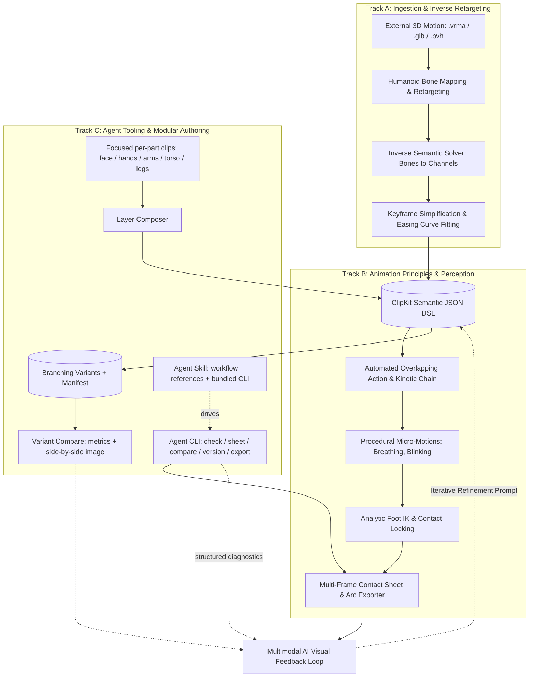

# ClipKit Web — Development Roadmap

## Strategic Objective

The goal of this roadmap is to elevate ClipKit Web from a declarative animation validator into an **autonomous AI animation production platform**. 

Currently, AI generates skeletal animation in a vacuum: it cannot visually inspect its own poses, must manually author every overlapping secondary motion, and lacks the ability to ingest real-world motion capture data. This roadmap establishes three convergent development tracks to solve these limitations:

1. **Track A: Motion Ingestion & Inverse Decomposition (Inbound)**: Ingest dense external 3D animations (`.vrma`, `.glb`, `.bvh`, mocap) and decompile them into clean, editable, semantic JSON DSL clips with sparse keyframes and easing curves.
2. **Track B: Animation Principles & Visual Perception (Outbound)**: Provide the AI with visual inspection tools (contact sheet strips with motion arcs) and automated animation mechanics (kinetic chain overlap, anticipation templates, procedural micro-motion, and foot locking IK).
3. **Track C: Agent Tooling & Modular Authoring (Foundation)**: Make ClipKit a tool an AI agent can drive in tight, verifiable loops: a headless CLI with structured diagnostics and rendered images, focused per-body-part authoring that can be composed, branching clip variants that can be compared, and packaging as an agent skill. Track C is executed first because the headless parts of Track B depend on it.

---

## Architectural Overview

---

## Track C: Agent Tooling & Modular Authoring (Foundation)

*Why this track exists*: an AI agent performs best on narrow, verifiable tasks: one body part, one motion, one variant at a time, with machine-readable feedback and a rendered image to look at. Asking for "a jumping punch with an angry face" in one shot spreads attention across too many constraints; asking for a jump, then a punch layer, then a face layer, then composing them keeps each step focused and each result checkable. Track C builds the foundation for that workflow. It is also a prerequisite for the headless parts of Track B (the contact sheet must render without a browser) and for packaging ClipKit as an agent skill.

### Phase C0: Architecture Hardening
*Objective: Make the layer boundaries real, so the domain and the renderers can run headless and new rules and panels can be added without editing existing code.*

- **C0.0 Validation Baseline**: Before touching `validate()`, record its output (all lines plus FAIL/WARN counts) for the 14 reference clips under each style (`realistic`, `stylized`, `exaggerated`) as a fixture. Every later refactor in this phase must reproduce it exactly, except where a change is listed explicitly. The existing golden tests cover pose evaluation and `.vrma` export, not validator text.
- **C0.1 Validation Rule Registry**: Replace the monolithic `validate()` with a registry of rule modules (`angular-speed`, `anatomy`, `floor`, `root-motion`, `windows`, `loop`, `vrm10`, `version`), each exposing `check({ rig, clip, limits })`. One unit test per rule.
- **C0.2 Ports & Dependency Inversion**: Define ports in `src/application/ports/` (`ClipRepository`, `MeshRenderer`, `MeshLoader`, `RigLoader`). `application/` and `presentation/` stop importing `infrastructure/`; `main.js` injects implementations.
- **C0.3 Pure Application Layer**: Remove `localStorage` from the clip store (behind `ClipRepository`) and DOM/`window` access from the theme module (presentation reads CSS; the CLI uses a constant palette).
- **C0.4 Exporter Relocation**: Move `vrma-exporter.js` out of `domain/validation/vrm10/` into `src/infrastructure/vrma/`, next to the future importer, so the round-trip pair lives together.
- **C0.5 Composition Root**: Reduce `main.js` to wiring. Scene drawing moves to `presentation/viewport/scene-renderer.js`; the frame loop moves to a playback controller; `refreshAll()` and `setTab()` are replaced by a panel registry.
- **C0.6 Registries Instead of Branching**: Channel types (`axis`, `pos`, aims) and easing curves become registries.
- **C0.7 Release Snapshots**: `history.json` holds, for every reference clip, a full copy of its behavior keys (`keys.json: behaviorKeys`) at its released version. `snapshotLines()` in `clip-store.js` uses it to detect a behavior change without a version bump. The copies are identical to the clips in `clips/` today, so naive de-duplication would remove every snapshot and make all 14 reference clips report "not released". Replace the full copies with a content hash per released version, or move the release record into the variant manifest (C2.4), and keep the version-bump check passing on all 14 clips.
- **C0.8 Boundary Enforcement**: An automated test fails on forbidden imports (domain imports nothing outside domain; application imports domain only; infrastructure imports domain only; presentation imports application and domain). `src/main.js` and `src/cli/` are composition roots and may import any layer.
- **C0.9 Single Agent API**: Replace the `window.ClipKit`, `window.VrmRig`, `window.VrmView` and `window.__clipkit` globals with one documented agent API that is also what the CLI uses.

**Deliverables**: `src/domain/validation/rules/*`, `src/application/ports/*`, `tests/architecture.test.js`, golden tests unchanged and still passing.

---

### Phase C1: Agent CLI & Structured Diagnostics
*Objective: An agent can validate a clip and look at the result in a single command, with output designed for machines first.*

- **C1.1 Structured Issue Model**: Every issue is an object `{ level, rule, channel, joint, t, value, limit, unit, keys, hint }` with a stable `rule` code. `hint` carries a computed, actionable value (for example the minimum key spacing that satisfies a speed limit). The existing text lines remain for the UI.
- **C1.2 Schema Validation First**: Structural checks run before physics checks and report the exact location with suggestions (`channels.neck_pitch: unknown channel, did you mean head_pitch?`).
- **C1.3 Commands**: `check`, `validate`, `schema`, `channels --part <part>`, `rules`, `export`, `sheet`; every command has `--help` with one example.
- **C1.4 Non-Interactive Contract**: No prompts. Exit codes: `0` pass, `1` validation failures, `2` usage or unreadable input, `3` internal error. Options `--json`, `--fail-on warn|fail`, `--max-issues`, `-` for stdin/stdout. Output is deterministic (no timestamps, no network).
- **C1.5 Headless Rendering (absorbs Phase 1)**: Reuse the existing 2D drawing functions (which already receive the canvas context as a parameter) with a Node canvas implementation. SVG output is the fallback if a native canvas is unavailable.
- **C1.6 Annotated Contact Sheet**: Frame timestamps, gameplay window bands, motion arcs, a grid scale, a fixed camera (so two variants are visually comparable), silhouette mode, multi-view, and a JSON metadata sidecar (frame times, camera, root travel).
- **C1.7 One-Call Iteration**: `check <clip> --sheet <dir> --json` runs schema, validation and rendering together and returns a compact summary plus absolute image paths.
- **C1.8 Part-Scoped Validation**: `--part face|hands|arms|legs|torso` runs only the rules relevant to those channels.
- **C1.9 Bundle & Startup Budget**: The CLI is a single bundled file without three.js, with a measured start-up time budget.
- **C1.10 Output Policy**: The CLI writes files only into directories named explicitly (`--out`, `--sheet`); it writes nothing by default. It refuses paths outside the working directory unless `--allow-outside` is given, and never overwrites an existing file without `--force`. `package.json` declares `engines` consistent with the Node version stated in the README.

**Deliverables**: `bin/clipkit` entry in `package.json`, `src/cli/*`, CLI golden tests that assert JSON output and sheet metadata (not pixels).

---

### Phase C2: Modular Composition & Variants
*Objective: Author one body part or one motion at a time, then combine; keep every iteration; compare objectively.*

- **C2.1 Part Partition**: `src/data/parts.json` assigns every channel (and `expressions`, `aims`, `move`) to `face`, `hands`, `arms`, `torso`, `legs` or `root`.
- **C2.2 Layers & Composition**: Clip schema gains `layers: [{ ref, channels, mode, offset }]` (`channels` accepts globs; `mode` is `override` or `additive`). A pure `composeClips()` in the domain returns an ordinary clip, so validation, preview and `.vrma` export work unchanged. Two layers writing the same channel produce a WARN.
  - `layers` is added to `behaviorKeys` in `src/data/keys.json`; otherwise the version diff and the behavior-change check ignore layer edits.
  - **Merge semantics must be specified and tested before implementation** (Open Decision 6). Proposed defaults:
    - `channels` and `pos` channels: `override` replaces the base keys, `additive` adds the layer value to the base value at each sample (degrees or meters respectively), then the result is range-checked.
    - Aim channels (`*_elev`, `*_azim`, `*_roll`): additive composition of direction angles is only an approximation of composing rotations, so aims default to `override`; `additive` on an aim emits a WARN.
    - `windows` and `events`: layer entries are shifted by `offset`; windows with the same name from two sources produce a WARN; events are concatenated and sorted by time.
    - `move` (root motion): exactly one source may own it.
    - `expressions`: per key, `override` or `additive`, clamped to the valid 0..1 range.
    - `duration`, `loop`, `claims`, `validate`: taken from the base clip. A layer longer than the base is clipped with a WARN; a shorter one holds its last value unless the base clip loops.
- **C2.3 Two-Level Validation**: Each layer is validated with only its relevant rules; the composite is then validated as a whole. Body parts are not fully independent (a punch layer that uses `twist` and `lean` changes balance during a jump), so shared torso channels use `additive` mode and an integration pass at the composite level is expected.
- **C2.4 Branching Variants**: Each clip is a folder of immutable versions with a `manifest.json` (`parent`, `note`, metrics). Refinement creates a child version; the parent is never overwritten without an explicit `--force`. The intended workflow is one variant per request with a distinct intent ("floatier", "heavier"), then refinement of a chosen variant, rather than requesting many variants at once.
  - Reconciliation with the existing release record: clips already carry `version`, `changelog` and a snapshot in `history.json` (C0.7). Proposed: `version` and `changelog` stay inside the clip; the manifest entry for a version carries the same number plus `parent`, `note` and metrics; the release hash from C0.7 lives in the manifest. A migration rule for the 14 existing clips must be documented before C2.4 starts.
- **C2.5 Compare**: `compare a b` reports per-joint metric differences (peak angular speed, airtime, root travel, FAIL/WARN counts) and renders both clips side by side with differently colored motion arcs. This generalizes the A/B comparison of Phase 2.4 to any two clips.
- **C2.6 Deterministic Edit Operations**: `mirror`, `retime`, `scale-amplitude`, `close-loop`, so small changes do not require rewriting a whole clip.
  - **`mirror` rule (checked against `evalPose` on the Motus rig).** For a randomized static pose (every channel set to a value between 20% and 80% of its range), swapping Left and Right and applying the rules below reproduces the reflected joint positions (x to -x, Left and Right joints exchanged) within 2e-5 m:
    - Swap L/R: every `*L`/`*R` channel (legs, knees, feet, elbows, fingers, `spread*`) and the `armL`/`armR` aims.
    - Negate: `side_lean`, `twist`, `hip_twist`, `hip_roll`, `head_yaw`, `hip_x`, and every aim `_roll`.
    - Keep as is: `lean`, `hip_pitch`, `head_pitch`, `hip_y`, `hip_z`, `legL_abd`/`legR_abd`, aim `_elev` and `_azim`, finger flexion, `spread*`.
    - Leaf joints and presets: `eye_yaw` (negated, "+ = looks to left"), `eye_pitch` and `jaw_open` (symmetric, kept), `expressions` (swap `blinkLeft`/`blinkRight` and `lookLeft`/`lookRight`), and `windows` (`planted_L` and `planted_R` exchanged).
    - Verified: `hip_roll` is confirmed negated (error < 0.02 mm when negated vs 493 mm when kept), matching pelvis tilt physics across the sagittal plane.
  - Acceptance tests: `mirror(mirror(clip))` equals `clip`; and for a set of poses every joint position equals the reflection of its counterpart, within 1e-4 m.
- **C2.7 Pose Library**: `src/data/poses/*.json` holds named poses (a single keyframe per channel, tagged with a part). Layers can reference a pose through `ref`, and any pose can be mirrored with C2.6. Commands: `clipkit poses list` and `clipkit poses show <name>`.

**Deliverables**: `src/domain/animation/compose.js`, `src/data/parts.json`, variant tree and A/B overlay in the UI.

---

### Phase C3: Agent Skill Packaging
*Objective: Ship ClipKit as an installable skill so an agent receives the workflow, the reference material and the tool together.*

- **C3.1 Skill Folder**: `skills/clipkit/` with `SKILL.md` (trigger description plus workflow rules: one part per task, one variant per request, validate and look at the sheet every iteration, never overwrite versions, compose last), `scripts/clipkit.mjs` (the bundled CLI), `references/` and `assets/examples/`.
- **C3.2 Generated References**: `channels.md`, the schema reference and the rule list are generated from the rig JSON and the rule registry by `npm run build:skill`, so documentation cannot drift from code. Hand-written references cover validation fixes, per-part guidance (face, hands, locomotion, combat) and animation principles.
- **C3.3 Staged Release**: v0 needs only C1 `validate` and `export` (no rendering); v1 adds `sheet` and per-part references; v2 adds `compare`, variants and `compose`.
- **C3.4 Evals**: Realistic prompts with verifiable outcomes (for example: a jump passes with zero FAIL and is saved as a new version; a "floatier" request creates a child version and leaves the parent untouched; adding an angry face changes only face channels).
- **C3.5 Distribution**: Package as a `.skill` file, and document the `.claude/skills/` setup for repository-based use.

**Deliverables**: `skills/clipkit/**`, `npm run build:skill`, eval cases under `skills/clipkit/evals/`.

---

## Phased Execution Plan (Tracks A and B)

### Phase 1: Visual Perception & Contact Sheet Exporter
*Objective: Enable multimodal AI to "see" key poses, silhouettes, and motion arcs without human intervention.*

> **Delivery note**: the headless renderer and annotated contact sheet are implemented through Phase C1 (`clipkit sheet`, C1.5-C1.6), which depends on Phase C0. The items below remain the functional requirements; the UI export button and the library method are delivered on top of the same code.

- **1.1 Multi-Frame Strip Renderer**: Implement a headless and client-side renderer that captures key action poses (e.g. 6 to 12 frames) across the animation timeline into a single composite image strip (contact sheet).
- **1.2 Silhouette & Framing Optimization**: Render clean character silhouettes against neutral backgrounds to allow multimodal models (e.g., Gemini Vision) to evaluate line of action, readability, and staging.
- **1.3 Motion Arc Overlay**: Render spatial trajectories of distal extremities (hands, feet, head) directly on the contact sheet to expose arc smoothness, inflection points, and pacing.
- **1.4 AI Inspection Contract**: Standardize the metadata output alongside the image (frame timestamps, camera angle, root travel distance) for direct injection into agent conversational context.

**Deliverables**:
- Export button on UI: `Export Contact Sheet (.png)`.
- Method `renderContactSheet(rig, ctx, clip, options)` on the documented agent API (Phase C0.9), also exposed as the CLI command `clipkit sheet`.

---

### Phase 2: Automated Overlap & Kinetic Chain Engine
*Objective: Eliminate stiff, robotic lockstep motion by propagating rotations through the skeletal hierarchy with natural drag and damping.*

- **2.1 Hierarchical Time Offsets**: Implement an automated post-pass that shifts keyframe timings based on anatomical depth:
  - Pelvis / Root ($t_0$) $\rightarrow$ Spine / Chest ($t_0 + \Delta t_1$) $\rightarrow$ Shoulders / Neck ($t_0 + \Delta t_2$) $\rightarrow$ Elbows / Wrists ($t_0 + \Delta t_3$) $\rightarrow$ Fingers ($t_0 + \Delta t_4$).
- **2.2 Damped Oscillation & Overshoot Calculator**: Calculate organic follow-through on rapid stops by appending subtle decaying sine oscillations (`outElastic` / damped sinusoidal decay) to distal joints.
- **2.3 Anticipation & Motion Templates**: Define reusable kinematic timing templates:
  - `Anticipation -> Acceleration -> Overshoot -> Settle`.
- **2.4 A/B Comparison Metric**: Provide side-by-side diffing of raw keyframed animation vs. overlap-processed motion.

**Deliverables**:
- Domain module: `src/domain/animation/overlap-processor.js`.
- UI Toggle and parameters in JSON Editor to apply and preview overlap curves non-destructively.
- Also available as a deterministic CLI operation and as a layer effect (Phase C2).

---

### Phase 3: Native VRMA & GLB Animation Importer
*Objective: Enable round-trip ingestion of `.vrma` and `.glb` files into the ClipKit ecosystem.*

- **3.1 glTF Animation Track Parser**: Extract raw sampler arrays (`time`, `rotations` as quaternions, `translations` as 3D vectors) from glTF binary structures (`VRMC_vrm_animation` and standard `animations` blocks).
- **3.2 Humanoid Retargeting & Rest-Pose Alignment**: Convert source rest orientations (including A-pose variations) to standard ClipKit / VRM 1.0 T-pose space.
- **3.3 Scale Normalization**: Scale hip displacement curves relative to character leg length to prevent floating or stunted movement across models.
- **3.4 Round-Trip Fidelity Benchmark**: Unit test verifying that exporting a default clip to `.vrma` and re-importing it produces joint angle differences under $1.0^\circ$.

**Deliverables**:
- Infrastructure module: `src/infrastructure/vrma/vrma-importer.js` (beside `vrma-exporter.js`, see Phase C0.4).
- File drop handler on UI accepting `.vrma` and animated `.glb` files.

---

### Phase 4: Inverse Semantic Solver & Keyframe Compressor
*Objective: Decompile dense 30/60 FPS sampled bone rotations into sparse, editable semantic channels with easing curves.*

- **4.1 Inverse Directional Solver (Arms & Legs)**: Calculate elevation, azimuth, and roll angles directly from bone direction vectors relative to chest and pelvis coordinate frames.
- **4.2 Axis-Decomposition Solver (Spine & Neck)**: Decompose multi-bone spinal curves into weighted `lean`, `twist`, and `bend` channels across the thoracic and lumbar segments.
- **4.3 Keyframe Reduction via Curve Fitting**: Implement Ramer-Douglas-Peucker (RDP) algorithm adapted for temporal easing curves:
  - Detect critical inflections, extremes, and tangents.
  - Fit optimal easing functions (`linear`, `inOutSine`, `outQuad`, `inQuad`) between sparse keyframes, reducing hundreds of baked samples into 3 to 6 keyframes per channel.
- **4.4 Fidelity Loss Telemetry**: Output a detailed difference report showing mean and peak angular error per bone between raw source and reconstructed JSON.
- **4.5 Jitter Filter**: Before the reduction of 4.3, apply a zero-phase low-pass filter (a Savitzky-Golay filter, or a Butterworth filter run forward and backward) to the semantic channels. The cutoff is configurable per part (higher for hands and fingers than for the torso). The filter must not smooth across `hold` easings or gameplay window boundaries. Report the residual high-frequency noise per channel in the 4.4 telemetry.

**Deliverables**:
- Domain module: `src/domain/animation/inverse-solver.js`.
- Compression report panel in UI showing source sample count vs. compressed keyframe count and fidelity score.

---

### Phase 5: BVH Mocap Ingestion & Bone Mapping
*Objective: Unlock open-source motion capture repositories (e.g. CMU Mocap, Mixamo BVH).*

- **5.1 BVH Parser**: Implement an in-browser parser for hierarchical ASCII BVH files.
- **5.2 Configurable Bone Mapping Table**: Provide alias dictionaries resolving arbitrary bone naming conventions (`Bip01_R_Hand`, `RightHand`, `r_wrist`, `mixamorig:RightHand`) to standard humanoid joints.
- **5.3 Automated Root Motion & Loop Detection**:
  - Automatically isolate horizontal displacement into `move` directional segments.
  - Detect cyclic periodicities in walk and run cycles to align start/end frames for seamless loops.
- **5.4 Automated Foot-Plant Extraction**: Measure vertical velocity and height of toe/foot joints to automatically generate planted intervals for validation.

**Deliverables**:
- Infrastructure module: `src/infrastructure/mocap/bvh-parser.js`.
- UI modal for custom bone mapping verification.

---

### Phase 6: Procedural Dynamics & Analytic Foot IK
*Objective: Guarantee anatomical stability and lifelike presence on resting or looped clips.*

- **6.1 Analytic Two-Bone Foot IK Solver**:
  - Implement two-bone analytical Inverse Kinematics for legs (`LeftUpLeg`, `LeftLeg`, `LeftFoot`).
  - Automatically pin the foot transform to the floor plane during contact intervals, eliminating foot sliding mathematically rather than merely flagging warnings.
  - Contract with the validator: `windows.planted_L` and `windows.planted_R`, already consumed by the foot-slide rule, are the intervals the solver pins. Both must use one shared definition of "planted" (a domain helper used by the rule and by the solver), and the foot-slide check must pass on clips that declare planted windows.
- **6.2 Procedural Idle Micro-Dynamics**:
  - Add optional non-destructive procedural layers: thoracic breathing cycle, subtle center-of-mass weight shifting, and natural eye saccades preceding head turns.
- **6.3 Center of Mass (CoM) Balance Validator**:
  - Project the character's center of mass onto the floor support polygon formed by planted feet to evaluate balance stability on grounded actions.

**Deliverables**:
- Domain module: `src/domain/rig/foot-ik-solver.js`.
- The CoM balance check (6.3) is added as a new rule module in the validation rule registry (Phase C0.1).
- Domain module: `src/domain/animation/procedural-micro-motion.js`.

---

## Technical Constraints & Specifications

1. **Lossy Conversion Budget**:
   - Mocap data possesses unconstrained rotational degrees of freedom (e.g. 3 independent spine bones, 30 finger joints). ClipKit abstracts the spine into weighted distributions and fingers into 12 primary channels. The inverse solver must maintain an average angular error $\le 3.5^\circ$ across limbs.
2. **Deterministic Browser Execution**:
   - All parsers, solvers, and curve fitters must execute entirely within the client runtime (pure JavaScript / WebAssembly where necessary) with zero external server dependencies.
3. **Round-Trip Integrity**:
   - Any animation imported from external sources must remain 100% compliant with ClipKit's validation engine and re-exportable to `.vrma`.
4. **Deterministic, Non-Interactive CLI**:
   - Identical input must produce byte-identical JSON output (no timestamps, randomness or network). This also makes golden tests possible.
5. **Token Budget**:
   - Default CLI output is compact: summary first, issues sorted by severity, repeated issues grouped with a count. Per-frame data is only emitted with an explicit verbose flag.
6. **Stable Rule Codes Are Public API**:
   - Agents and skills depend on rule codes. Renaming or removing a code is a versioned, documented change.
7. **Enforced Layer Boundaries**:
   - Domain, application, infrastructure and presentation dependencies are checked by an automated test (Phase C0.8), not only by convention.

---

## Prioritized Implementation Schedule

| Milestone | Target Scope | Strategic Impact |
|---|---|---|
| **Step 0** | Phase C0 (Architecture Hardening) | **Foundation**: makes layer boundaries real, enables headless rendering and cheap addition of rules, panels and importers. |
| **Step 1** | Phase C1 (Agent CLI & Structured Diagnostics), which delivers Phase 1 (Contact Sheet) | **Immediate**: the agent can validate and see its own output in one command. |
| **Step 2** | Phase C3 v0-v1 (Skill: validate, export, sheet, per-part references) | **High**: first complete agent loop; needs only C1. |
| **Step 3** | Phase C2 (Composition & Variants) and Skill v2 | **High**: focused per-part authoring, branching variants, objective comparison. |
| **Step 4** | Phase 2 (Overlap Processor) | **High**: fixes stiff, lockstep AI motion. |
| **Step 5** | Phase 3 (VRMA & GLB Importer) | **High**: round-trip validation and import of existing VRM 1.0 clips. |
| **Step 6** | Phase 4 (Inverse Solver & Keyframe Compressor) | **Critical**: converts dense raw samples into sparse, readable JSON DSL. |
| **Step 7** | Phase 5 (BVH Mocap Parser & Auto-Root Extractor) | **High**: unlocks large external motion capture libraries as AI reference data. |
| **Step 8** | Phase 6 (Foot IK Contact Locking & Micro-Dynamics) | **Polish**: solves foot sliding permanently and adds biological presence. |

---

## Deferred / Out of Scope (for now)

These appear in professional toolsets but are intentionally not planned. Each can be revisited once its prerequisite exists.

- **Space switching and props**: needs a prop and constraint model in the DSL; the rig is body-only. Revisit after layers (Phase C2).
- **Pose Space Deformation and corrective blend shapes**: mesh deformation belongs to the engine or the DCC tool, not to a skeletal animation validator.
- **Ragdoll, articulated-body physics and AutoPhysics**: simulation conflicts with the deterministic, GPU-free evaluator unless it is run offline and baked into keyframes.
- **Spring bones**: VRM 1.0 defines `VRMC_springBone`, which runtimes simulate; ClipKit exports animation only and neither authors nor simulates it.
- **Interactive Bezier graph editor**: the DSL uses named easings; handle-based curves would need a new `format_version`. Adding easing presets is the agent-friendly alternative.
- **IK beyond legs** (hand targets, reaching): needs target semantics in the DSL.
- **AI inbetweening inside ClipKit**: the language model is external by design; ClipKit supplies validation and feedback, not generation.

---

## Open Decisions

1. **Canonical message language.** Validator messages are currently in Indonesian while documentation is in English. Options: one canonical language, or language-neutral rule codes with localized message templates. Rule codes are stable either way. Recommendation: language-neutral rule codes with message templates per language, English as the default and Indonesian kept as a locale (`--lang en|id`), so agents and the existing UI both keep working.
2. **Native canvas availability.** The headless renderer assumes a Node canvas package installs on the target environment; the SVG fallback (and how it is rasterized) must be decided.
3. **Schema versioning.** Whether `layers` fits within `format_version: 1` or requires `format_version: 2`. Existing clips must remain valid in both cases.
4. **Variant storage.** A folder per clip in the repository (natural for git and repository-based agents) versus an exportable bundle that the user keeps (needed where an agent's working files do not persist between sessions).
5. **Mesh rendering in the CLI.** The first release renders the skeleton only; VRM mesh rendering needs WebGL and would go through a headless browser.
6. **Layer merge semantics.** The per-field rules proposed in Phase C2.2 (channels, aims, positions, windows, events, move, expressions, duration) need review and a test per rule before implementation.
7. **`mirror` and `hip_roll` (Resolved).** Numerical evaluation on the Motus rig confirms `hip_roll` must be negated under mirror, consistent with pelvis tilt physics across the sagittal plane (error < 0.02 mm when negated vs 493 mm when kept).
8. **Release record migration.** How `version`, `changelog` and the `history.json` snapshots map onto variant manifests (see C0.7 and C2.4), and how the 14 existing clips migrate.
