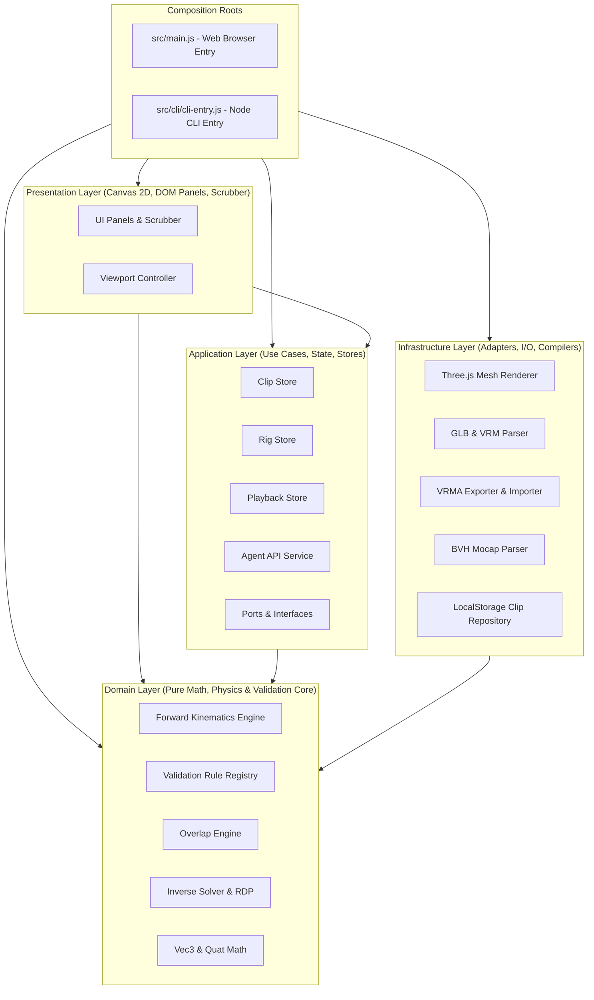

# ClipKit Web Architecture Guide

ClipKit Web is structured according to strict **Clean Architecture (Hexagonal / Ports & Adapters)** principles. This architecture guarantees that core animation kinematics, mathematical solvers, and validation algorithms remain completely independent of browsers, WebGL renderers, UI frameworks, and storage drivers.

---

## Architectural Layers



---

## Layer Dependency Rules

Layer boundary constraints are strictly enforced in every CI run via `tests/architecture.test.js`:

1. **Domain Layer (`src/domain/`)**:
   - Contains pure algorithms, kinematics, easing mathematics, and validation rules.
   - **Forbidden**: Must NEVER import from Application, Infrastructure, Presentation, or external libraries (e.g. Three.js, Node.js `fs`, DOM `window`).
2. **Application Layer (`src/application/`)**:
   - Coordinates application state, playback timers, and defines Ports (abstract interfaces).
   - **Allowed**: Can import Domain and Data only.
   - **Forbidden**: Cannot import Infrastructure or Presentation.
3. **Infrastructure Layer (`src/infrastructure/`)**:
   - Concrete implementations of ports: Three.js WebGL renderer, binary glTF parser/builder, local storage repo, mocap parser.
   - **Allowed**: Can import Domain and Data only.
   - **Forbidden**: Cannot import Application or Presentation.
4. **Presentation Layer (`src/presentation/`)**:
   - Canvas 2D renderers, DOM UI panels, timeline scrubber, and viewport gesture handlers.
   - **Allowed**: Can import Application, Domain, and Data.
   - **Forbidden**: Cannot import Infrastructure directly (uses injected ports).
5. **Composition Roots (`src/main.js` and `src/cli/`)**:
   - The only locations permitted to import concrete Infrastructure adapters and inject them into Application ports (Dependency Inversion).

---

## Port & Adapter Interfaces

In `src/application/ports/`, interfaces define required capabilities:
- **`ClipRepository`**: `load(id)`, `save(id, clip)`, `list()`, `delete(id)`. Implemented by `LocalStorageClipRepository`.
- **`MeshRenderer`**: `mount(canvas)`, `load(key, buffer)`, `pose(transforms)`, `unload()`. Implemented by `ThreeMeshRenderer`.
- **`RigLoader`**: `parseRigFile(buffer, fileName, baseRig)`. Implemented by `GlbParser`.

---

## Kinematics & Compilation Pipelines

### 1. Forward Kinematics Pipeline (DSL -> Pose Evaluation)
```
JSON DSL Keyframes
  └─> Keyframe Sampler (evalKeyframe with Easing)
        └─> Semantic Channel Values (degrees, meters)
              └─> Rig Context & Forward Kinematics (FK pose evaluator)
                    └─> 55-Bone Skeletal Transforms (World Matrices)
                          ├─> Validation Rule Registry (Diagnostics)
                          ├─> 2D/3D Viewport Renderer (Display)
                          └─> VRMA Exporter (glTF Compilation)
```

### 2. Inbound Ingestion Pipeline (Mocap -> DSL)
```
Raw Animation (BVH / VRMA / GLB)
  └─> Joint Quaternions & Root Trajectory (30 FPS)
        └─> Zero-Phase Bidirectional Jitter Filter
              └─> Directional Aim Solver & Torso Decomposition
                    └─> RDP Trajectory Simplifier + Easing Curve Fitting
                          └─> Sparse ClipKit JSON Clip (> 60% compression)
```
