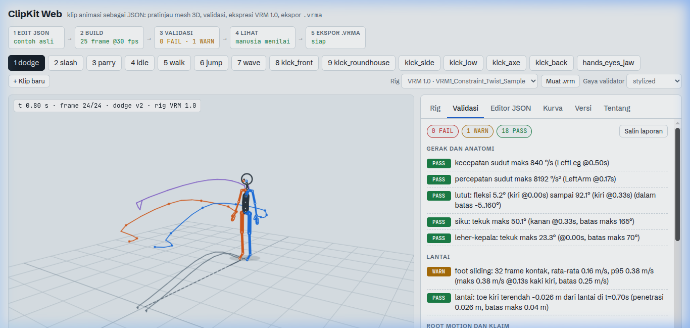
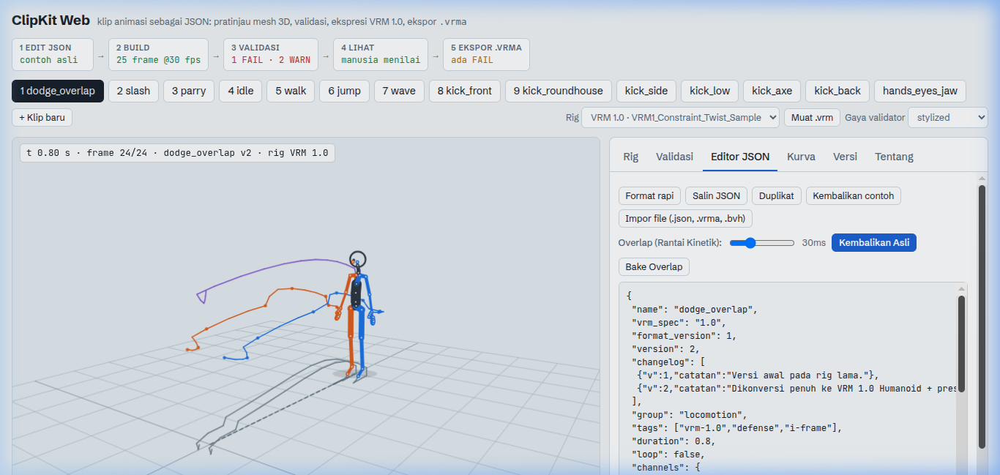
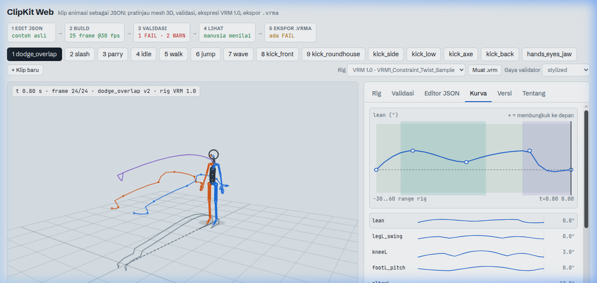
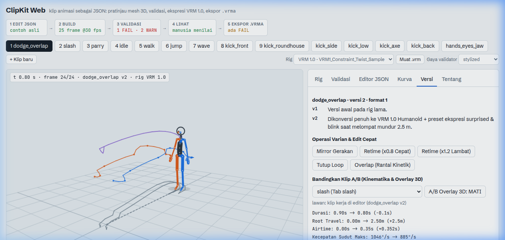
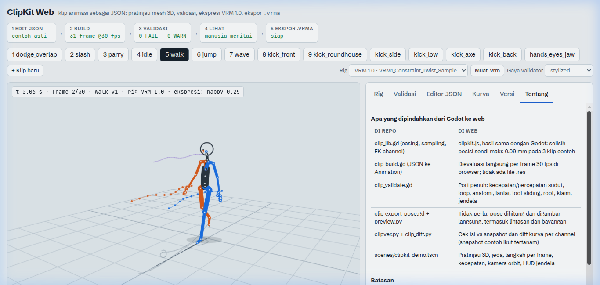

# ClipKit Web UI Guide

The **ClipKit Web Interface** is a browser-based 3D animation sandbox, linter, and real-time visualizer. It provides interactive viewport controls, playback scrubbing, JSON editing with live compilation, and procedural animation processing.

---

## 1. 3D Viewport & Clipbar

The main 3D viewport renders 55-bone skeletal forward kinematics and high-polygon VRM meshes simultaneously using WebGL:

### Key Features
- **Top Clipbar**: Quick-switch pills for reference animations (`idle`, `walk`, `run`, `slash`, `dodge`, `punch_r`, `kick_high`, etc.) and user-authored clips.
- **Camera Presets**: Fast viewpoint switcher buttons on top of viewport:
  - `Q`: Three-quarter perspective angle.
  - `F`: Front view (XY plane).
  - `S`: Side view (ZY plane).
  - `T`: Top view (XZ plane).
  - `Fit`: Reset camera position to center character.
- **Mesh & Skeleton Toggles**:
  - `Mesh`: Toggles textured 3D VRM avatar mesh.
  - `Skel`: Toggles color-coded skeletal joints and bones.

---

## 2. Real-Time Validation Panel

The **Validasi** panel runs the automated rule registry across every frame at 30 FPS:

### Diagnostics Output
- **Overall Verdict**: Displays total `FAIL` (anatomical violations, floor clipping), `WARN` (stylistic velocity warnings), and `PASS` counts.
- **Rule Matrix**: Heuristic checks for:
  - Angular velocity and acceleration.
  - Knee and elbow anatomical limits.
  - Foot floor penetration and sliding during contact windows.
  - VRM 1.0 humanoid required bone mapping.
  - Cyclic loop boundary smoothness.

---

## 3. JSON Editor & Procedural Overlap Controls

The **Editor JSON** panel allows live authoring, formatting, duplication, and procedural kinetic chain processing:

### Actions & Workflow
- **Live Rebuild**: Any text edit in the JSON area immediately recompiles the pose and updates the 3D viewport.
- **Action Buttons**:
  - `Format rapi`: Formats JSON indentation deterministically.
  - `Salin JSON`: Copies current clip JSON to clipboard.
  - `Duplikat`: Creates an editable working copy of the active clip.
  - `Impor file (.json, .vrma, .bvh)`: Ingests external mocap or animation clips directly into the editor.
- **Procedural Overlap Engine**:
  - `Step delay`: Adjusts hierarchical delay (in milliseconds) propagating from pelvis to spine, shoulders, and wrists.
  - `Pratinjau Overlap`: Temporarily bakes overlap delay for non-destructive live playback.
  - `Terapkan Overlap`: Permanently commits calculated delay keyframes to the JSON text.

---

## 4. Animation Curves Visualization

The **Kurva Animasi** panel visualizes trajectories and spline tangents across time:

- Each rotational channel is plotted as a colored SVG spline.
- Scrubbing the timeline moves the synchronized playhead line across the curves.
- Inflection points, keyframe nodes, and easing segments can be visually inspected for smoothing and continuity.

---

## 5. Versions, Variants & Kinematic Compare

The **Versi & Varian** panel manages immutable version history and differential analysis:

### Features
- **Changelog History**: Lists version tags and release notes.
- **Rapid Variant Operations**:
  - `Mirror L/R`: Deterministically swaps left/right limbs and inverts roll axes.
  - `Perlambat 20%` / `Percepat 20%`: Non-destructive retiming.
  - `Tutup Loop`: Blends ending pose seamlessly into initial pose.
- **Kinematic Compare**: Selects a secondary clip and evaluates differential metrics (peak speed differences, airtime, and travel distance).

---

## 6. Locomotion & Playback Scrubbing

Interactive timeline scrubber with playback controls, playback speed selector (0.25x, 0.5x, 1x, 2x), and root motion tracking:

